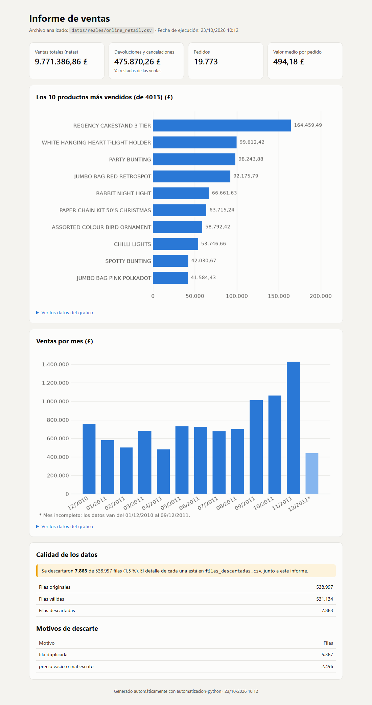
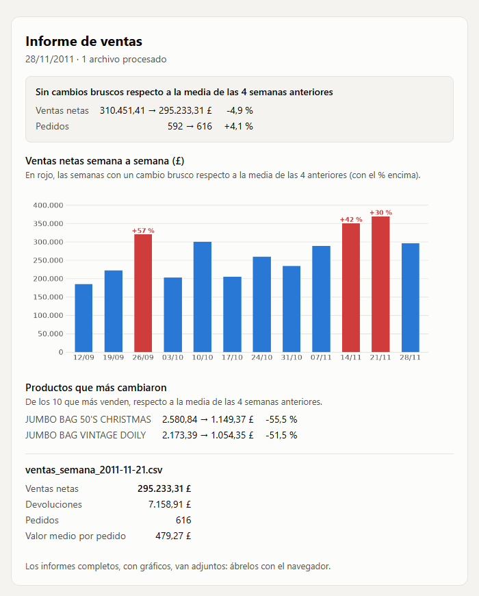
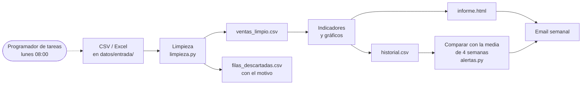

# Automatización de limpieza de datos de ventas

[](https://github.com/tcpalbertvaldivia1993-lang/automatizacion-python/actions/workflows/pruebas.yml)


Herramienta en Python que hace el trabajo semanal de un analista de datos sin que nadie
la toque: recibe archivos de ventas (CSV o Excel), **limpia los datos y explica cada
error**, calcula los indicadores, genera un **informe HTML con gráficos** y lo **envía
por email** cada lunes, **avisando si las ventas cambian bruscamente**.

Probada con **541.909 ventas reales** de una tienda online
([Online Retail, UCI](https://archive.ics.uci.edu/dataset/352/online+retail)).

| Informe (un año de datos reales) | Email de los lunes (12 semanas reales) |
|---|---|
| [](docs/capturas/informe.png) | [](docs/capturas/email.png) |

## En resumen

- **Limpieza de datos con pandas:** duplicados, espacios, fechas imposibles o futuras,
  cantidades y precios inválidos. Cada fila descartada se guarda con su motivo, y los
  formatos recuperables (`7,50`, `899.99 €`) se corrigen en vez de eliminarse.
- **Reglas de negocio:** las devoluciones y cancelaciones se restan de las ventas, los
  gastos de envío y comisiones no cuentan como productos, y los meses incompletos se
  marcan para que no parezcan una caída.
- **Informes:** HTML de un solo archivo (Jinja2 + matplotlib), adaptado al móvil y con
  números en formato español.
- **Automatización:** procesa carpetas enteras, se ejecuta sola cada semana con el
  Programador de tareas de Windows y envía el resultado por email (SMTP).
- **Detección de anomalías:** compara cada semana con la media de las 4 anteriores.
- **Calidad:** 40 pruebas con pytest que se ejecutan en GitHub Actions con cada cambio.

**Tecnologías:** Python · pandas · matplotlib · Jinja2 · openpyxl · pytest ·
GitHub Actions · Jupyter · SMTP · Programador de tareas de Windows + WSL

## Cómo funciona



## Resultados con datos reales

Con el conjunto Online Retail completo (un año, tienda británica, importes en £):

| | |
|---|---|
| Filas procesadas | 538.997 |
| Filas válidas | 531.134 (se descartan 5.367 duplicadas y 2.496 con precio inválido) |
| Ventas netas | 9.771.386,86 £ |
| Devoluciones y cancelaciones | 475.870,26 £ (ya restadas) |
| Pedidos | 19.773 · valor medio 494,18 £ |
| Tiempo | ~25 segundos |

## Problemas encontrados y decisiones

Los datos de ejemplo funcionaban desde el principio, pero los datos reales sacaron a la
luz problemas que no se ven con un CSV pequeño:

- **Las fechas llevaban hora** (`2010-12-01 08:26:00`) y la validación las rechazaba
  todas. Ahora se aceptan con o sin hora y se guardan solo con el día.
- **Los gastos de envío y comisiones aparecían como "productos"**: el más vendido era
  "DOTCOM POSTAGE" (206.245 £ de gastos de envío). Se identifican por su código y se
  apartan antes de analizar.
- **Las cancelaciones se ignoraban** mientras los pedidos originales seguían contando,
  así que las ventas salían infladas. Ahora una cantidad negativa se resta.
- **El último mes parecía una caída de ventas**, pero solo tenía 9 días de datos. Ahora
  los meses incompletos se marcan con `*` y un color más claro.
- **Los gráficos eran ilegibles** con 4.000 productos o 365 días: se muestran los 10
  productos que más venden y, si hay más de dos meses, las ventas por mes.
- **Los avisos saltaban casi todas las semanas.** Al simular 12 lunes con datos reales,
  comparar cada semana solo con la anterior daba aviso en 8 de 11 semanas: en esta
  tienda las ventas varían ±30 % de forma normal. Comparando con la **media de las 4
  semanas anteriores** y un umbral del 30 %, el aviso salta en 3 de 11 semanas, dos de
  ellas por la subida real de la campaña de Navidad. Por producto la variación es
  todavía mayor (un solo pedido grande la cambia), así que los productos se muestran
  como información y no como aviso.

---

## Qué hace, en detalle

1. **Limpieza**
   - Quita espacios innecesarios (al principio, al final y dobles espacios).
   - Elimina filas duplicadas.
   - Elimina fechas vacías, con formato distinto de `AAAA-MM-DD`, imposibles
     (`2026-13-45`, `2026-02-30`) o futuras.
   - Elimina cantidades vacías, no numéricas, decimales o 0.
     Una cantidad **negativa** es una devolución o cancelación: no se elimina,
     se resta de las ventas y no cuenta como pedido.
   - Elimina precios vacíos, mal escritos (`abc`) o ≤ 0.
     Los formatos recuperables como `7,50` o `899.99 €` se corrigen en lugar de eliminarse.
2. **Indicadores**: ventas totales netas, devoluciones y cancelaciones,
   número de pedidos y valor medio por pedido.
   Además, gráficos de **ventas por producto** (los 10 que más venden si hay
   muchos) y **ventas por día** (por mes si los datos abarcan más de dos meses).
   Los periodos sin ventas aparecen con 0, y el primer o último mes con datos
   incompletos se marca con `*` y un color más claro. Cada gráfico lleva su tabla de datos.
3. **Resultados** (carpeta `resultados/`, con una subcarpeta por archivo):
   - `<archivo>/ventas_limpio.csv`: datos limpios, con la columna `importe`.
   - `<archivo>/filas_descartadas.csv`: cada fila eliminada con su motivo.
   - `<archivo>/informe.html`: informe con indicadores, gráficos y calidad de los datos.
     Es un solo archivo (los gráficos van dentro): se abre con doble clic en cualquier
     navegador, se puede enviar por email y se adapta al móvil. Números en formato español.
   - `<archivo>/graficos/`: los gráficos en PNG.
   - `resumen.html`: al procesar una carpeta, una tabla que compara todos los archivos.
   - `registro.log`: registro de todas las ejecuciones.
   - `historial.csv`: totales de cada ejecución programada, para detectar cambios bruscos.
   - `historial_productos.csv`: ventas de cada producto en cada ejecución programada.
   - `evolucion.png`: gráfico de las ventas netas semana a semana.

## Estructura

```
datos/ventas_ejemplo.csv        CSV de ejemplo con errores a propósito
limpieza.py                     funciones de limpieza e indicadores
graficos.py                     gráficos del informe (matplotlib)
plantillas/                     diseño HTML de los informes y del email (Jinja2)
formato.py                      números en formato español: 1.234,56
enviar_email.py                 envío de los informes por email (SMTP)
alertas.py                      historial de ejecuciones y aviso de cambios bruscos
.env.ejemplo                    plantilla de la configuración del email
preparar_online_retail.py       descarga y adapta un conjunto de datos real
main.py                         ejecución automática (un archivo o una carpeta)
ejecutar_programado.sh          lo que ejecuta la tarea programada: procesa datos/entrada/
programar_windows.ps1           crea la tarea en el Programador de tareas de Windows
datos/entrada/                  carpeta de entrada para la ejecución programada
notebooks/analisis_ventas.ipynb el mismo proceso paso a paso
tests/                          pruebas con pytest
docs/capturas/                  capturas de este README
.github/workflows/pruebas.yml   ejecuta las pruebas en GitHub con cada push
```

## Cómo usarlo

```bash
python3 -m venv venv
venv/bin/pip install -r requirements.txt

venv/bin/python main.py                        # usa el CSV de ejemplo
venv/bin/python main.py ruta/a/mis_ventas.csv  # un CSV
venv/bin/python main.py ruta/a/mis_ventas.xlsx # un Excel
venv/bin/python main.py ruta/a/carpeta/        # todos los CSV y Excel de una carpeta
venv/bin/python main.py ventas.csv --moneda £   # otra moneda en el informe
venv/bin/python main.py --enviar-email          # enviar los informes por email

venv/bin/jupyter notebook notebooks/          # abrir el notebook
venv/bin/python -m pytest                     # ejecutar las pruebas
```

El archivo debe tener las columnas:
`id_pedido, fecha, cliente, producto, cantidad, precio_unitario`.
Las fechas pueden ir con o sin hora (`2026-09-01` o `2026-09-01 08:26:00`).

## Probarlo con datos reales

`preparar_online_retail.py` descarga el conjunto de datos público
[Online Retail (UCI)](https://archive.ics.uci.edu/dataset/352/online+retail):
541.909 ventas reales de una tienda online británica (2010-2011). Después:

- Aparta las 2.912 filas que no son productos (envíos, comisiones y ajustes,
  identificados por su código) en `datos/reales/online_retail_excluidas.csv`.
- Cambia los nombres de las columnas a los que espera la herramienta.

Las cancelaciones de este conjunto (pedidos que empiezan por `C`) tienen cantidad
negativa, así que la herramienta las resta de las ventas automáticamente.
Los importes están en libras, así que conviene usar `--moneda £`.

```bash
venv/bin/python preparar_online_retail.py              # ~2 min, solo la primera vez
venv/bin/python main.py datos/reales/online_retail.csv --moneda £ # ~25 s
```

Los datos reales se guardan en `datos/reales/`, que no se sube a GitHub.

## Ejecución programada

Deja los archivos de ventas en `datos/entrada/`. Cada lunes a las 08:00, el
**Programador de tareas de Windows** abre WSL y ejecuta `ejecutar_programado.sh`, que:

1. procesa todos los CSV y Excel de `datos/entrada/`,
2. genera sus informes y `resultados/resumen.html`,
3. mueve los que salieron bien a `datos/entrada/procesados/` (los que fallan se quedan,
   para revisarlos con `resultados/registro.log`),
4. compara los totales con la media de las 4 semanas anteriores (`resultados/historial.csv`),
5. envía un email con los indicadores de cada archivo, sus informes HTML adjuntos,
   el gráfico de evolución y un aviso si las ventas o los pedidos cambiaron bruscamente.

Si el PC estaba apagado el lunes a las 08:00, la tarea se ejecuta en cuanto se enciende.
Se usa el Programador de tareas y no `cron` porque `cron` solo funciona con WSL abierto.

Para crear la tarea (una sola vez, desde WSL):

```bash
powershell.exe -NoProfile -ExecutionPolicy Bypass -File "$(wslpath -w programar_windows.ps1)"
```

Para verla o cambiarla: menú Inicio → "Programador de tareas" →
"automatizacion-python - informe semanal".

## Envío por email

1. Copia la plantilla de configuración: `cp .env.ejemplo .env`
2. Rellena `.env` con el servidor, tu cuenta, la contraseña y el destinatario.
   Con Gmail hace falta una **contraseña de aplicación**
   ([cómo crearla](https://myaccount.google.com/apppasswords)), no tu contraseña normal.
3. Pruébalo: `venv/bin/python main.py --enviar-email`

El email lleva en el cuerpo los indicadores de cada archivo (y avisa si alguno falló), y
los informes completos como adjuntos HTML. Los gráficos de los informes van en los
adjuntos porque Gmail bloquea las imágenes en base64; el gráfico de evolución sí va en
el cuerpo, como imagen incrustada con `cid:`, que Gmail muestra.

`.env` contiene tu contraseña: está en `.gitignore` y **nunca** se sube a GitHub.

## Aviso de cambios bruscos

Con `--historial`, cada ejecución guarda sus totales (ventas netas, devoluciones,
pedidos y valor medio) en una fila de un CSV. La siguiente ejecución los compara con
la **media de las 4 ejecuciones anteriores** (o de las que haya, al principio): si las
**ventas netas** o los **pedidos** suben o bajan un 30 % o más, es un cambio brusco.

```bash
venv/bin/python main.py datos/entrada --historial resultados/historial.csv
venv/bin/python main.py datos/entrada --historial resultados/historial.csv --umbral 40
```

- El registro muestra un aviso: `Cambio brusco en ventas netas: -31.2 %`.
- Con `--enviar-email`, el email incluye un recuadro con la comparación (en rojo si
  hay un cambio brusco) y el asunto lo avisa: `Informe de ventas · 23/10/2026 · ⚠ Ventas netas -31 %`.

Se compara con la media y no solo con la semana anterior porque las ventas varían mucho
de una semana a otra (ver [Problemas encontrados y decisiones](#problemas-encontrados-y-decisiones)).

**Productos que más cambiaron:** también se guardan las ventas de cada producto en
`historial_productos.csv` (junto a `historial.csv`). De los 10 productos que más venden
de media, el email muestra hasta 5 que hayan cambiado un 50 % o más (se cambia con
`--umbral-producto`). Es solo informativo, sin aviso en rojo ni en el asunto: un solo
pedido grande ya cambia mucho las ventas de un producto.

Desde la segunda ejecución se dibuja además `resultados/evolucion.png`: un gráfico con
las ventas netas de las últimas 12 ejecuciones (semanas), con en rojo y su % las que
cambiaron bruscamente. Va dentro del cuerpo del email y en `resumen.html`.

La ejecución programada ya usa `resultados/historial.csv`. Las ejecuciones a mano sin
`--historial` no se guardan, para que las pruebas no estropeen la comparación. La
primera vez no hay nada con qué comparar.

## Datos

El conjunto Online Retail es de Daqing Chen (2015), publicado en el
[UCI Machine Learning Repository](https://archive.ics.uci.edu/dataset/352/online+retail)
con licencia CC BY 4.0.
