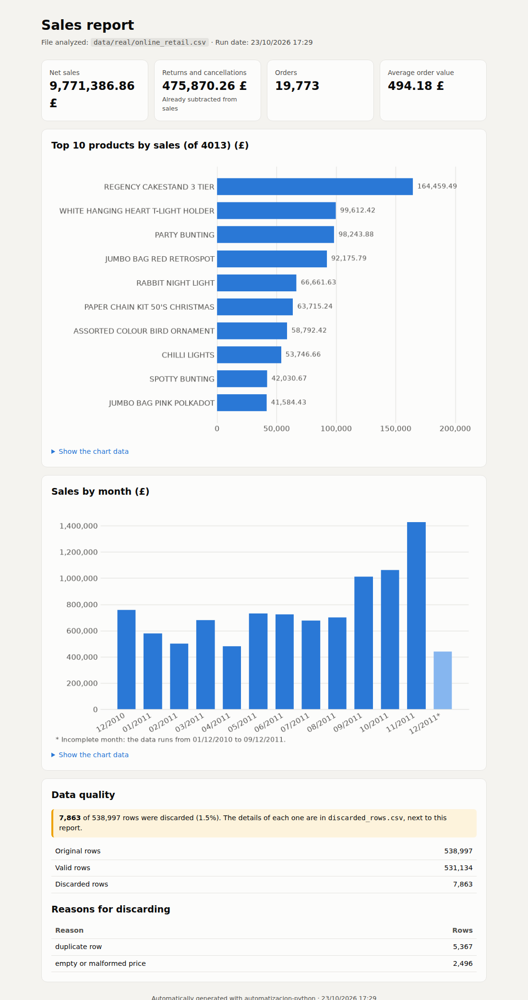
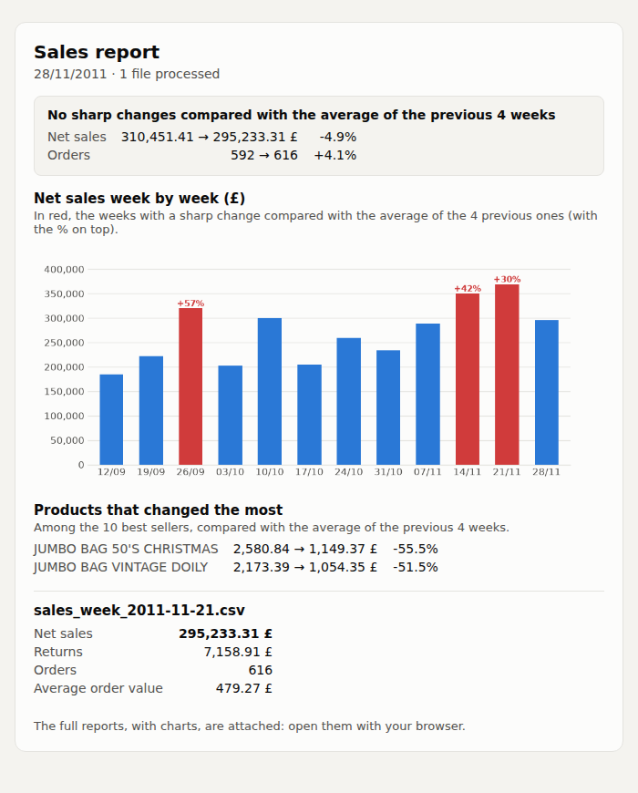
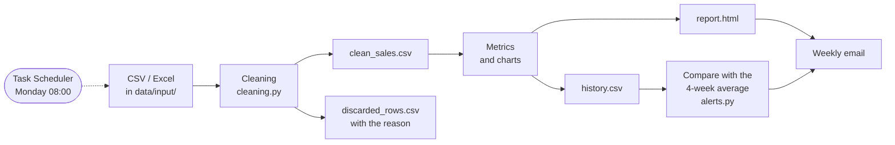
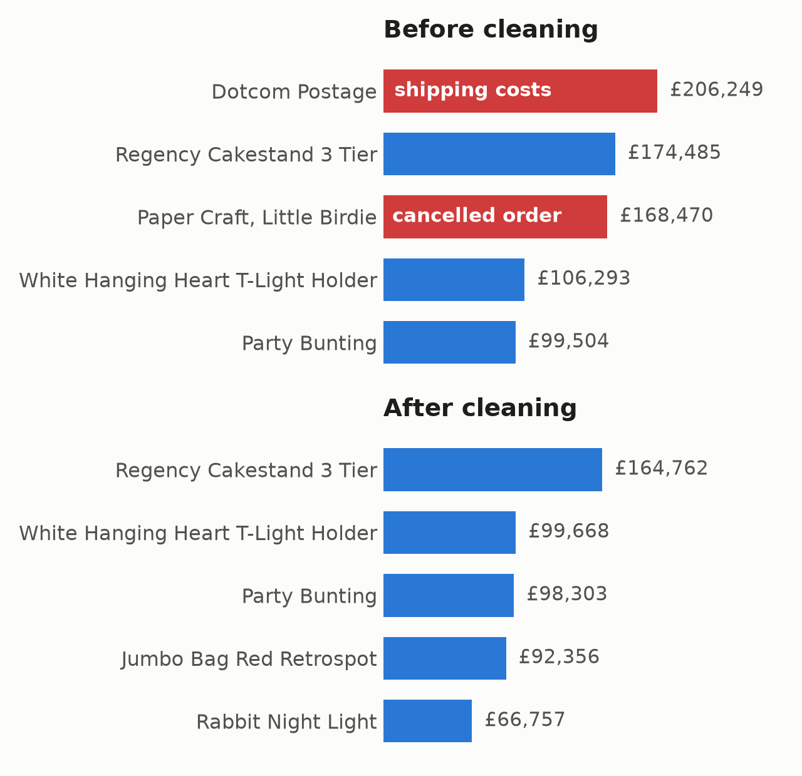
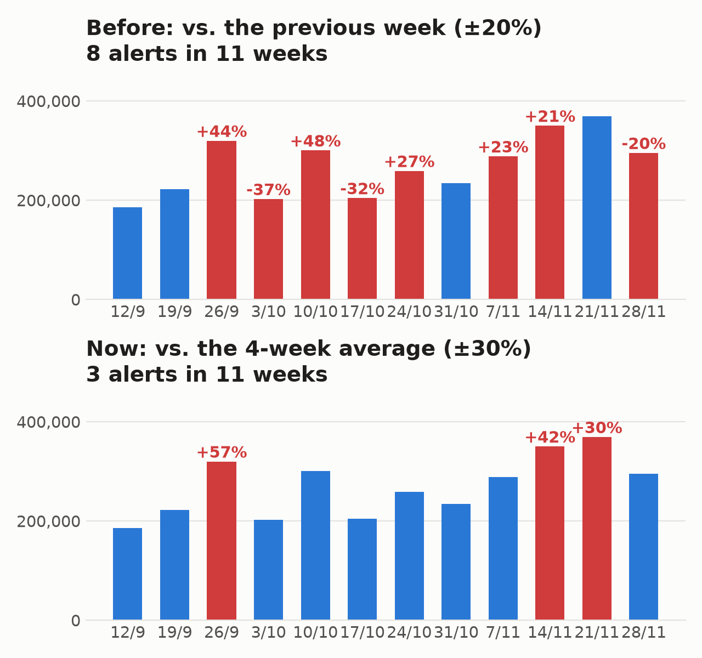

# Sales data cleaning automation

[](https://github.com/tcpalbertvaldivia1993-lang/automatizacion-python/actions/workflows/tests.yml)


A Python tool that does a data analyst's weekly work with nobody touching it: it takes
sales files (CSV or Excel), **cleans the data and explains every error**, calculates the
metrics, builds an **HTML report with charts** and **emails it** every Monday,
**alerting if sales change sharply**.

Tested with **541,909 real sales** from an online shop
([Online Retail, UCI](https://archive.ics.uci.edu/dataset/352/online+retail)).

| Report (one year of real data) | Monday email (12 real weeks) |
|---|---|
| [](docs/screenshots/report.png) | [](docs/screenshots/email.png) |

## At a glance

- **Data cleaning with pandas:** duplicates, extra spaces, impossible or future dates,
  invalid quantities and prices. Every discarded row is saved with its reason, and
  recoverable formats (`7,50`, `£899.99`) are fixed instead of removed.
- **Business rules:** returns and cancellations are subtracted from sales, shipping
  costs and fees don't count as products, and incomplete months are marked so they
  don't look like a drop.
- **Reports:** single-file HTML (Jinja2 + matplotlib), mobile-friendly.
- **Automation:** processes whole folders, runs by itself every week with the Windows
  Task Scheduler and sends the result by email (SMTP).
- **Anomaly detection:** compares each week with the average of the previous 4.
- **Quality:** 40 pytest tests that run on GitHub Actions with every change.

**Tech:** Python · pandas · matplotlib · Jinja2 · openpyxl · pytest ·
GitHub Actions · Jupyter · SMTP · Windows Task Scheduler + WSL

## How it works



## Results with real data

With the full Online Retail dataset (one year, UK shop, amounts in £):

| | |
|---|---|
| Rows processed | 538,997 |
| Valid rows | 531,134 (5,367 duplicates and 2,496 with an invalid price are discarded) |
| Net sales | £9,771,386.86 |
| Returns and cancellations | £475,870.26 (already subtracted) |
| Orders | 19,773 · average £494.18 |
| Time | ~25 seconds |

## Problems found and decisions

The sample data worked from the start, but the real data brought to light problems you
don't see with a small CSV:

- **Dates had a time** (`2010-12-01 08:26:00`) and the validation rejected all of them.
  Now they're accepted with or without a time and stored as just the day.
- **Shipping costs and fees showed up as "products"**: the best seller was
  "DOTCOM POSTAGE" (£206,245 of shipping costs). They're identified by their code and
  set aside before the analysis.
- **Cancellations were ignored** while the original orders still counted, so sales came
  out inflated. Now a negative quantity is subtracted.
- **The last month looked like a drop in sales**, but it only had 9 days of data. Now
  incomplete months are marked with `*` and a lighter color.
- **The charts were unreadable** with 4,000 products or 365 days: they show the 10
  best-selling products and, if there are more than two months, sales by month.
- **The alerts went off almost every week.** Simulating 12 Mondays with real data,
  comparing each week only with the previous one (20% threshold) raised an alert in 8 of
  11 weeks: in this shop sales normally swing ±30%. Comparing with the **average of the
  previous 4 weeks** and a 30% threshold, the alert goes off in 3 of 11 weeks, two of
  them because of the real rise of the Christmas season. Per product the variation is
  even larger (a single large order changes it), so products are shown as information
  and not as an alert.

| Products before and after cleaning | Alerts before and after the change |
|---|---|
| [](docs/screenshots/products_before_after.png) | [](docs/screenshots/alerts_before_after.png) |

---

## What it does, in detail

1. **Cleaning**
   - Removes unnecessary spaces (leading, trailing and double spaces).
   - Removes duplicate rows.
   - Removes dates that are empty, in a format other than `YYYY-MM-DD`, impossible
     (`2026-13-45`, `2026-02-30`) or in the future.
   - Removes quantities that are empty, non-numeric, decimal or 0.
     A **negative** quantity is a return or cancellation: it isn't removed,
     it's subtracted from sales and doesn't count as an order.
   - Removes prices that are empty, malformed (`abc`) or ≤ 0.
     Recoverable formats such as `7,50` or `£899.99` are fixed instead of removed.
2. **Metrics**: net sales, returns and cancellations, number of orders and average
   order value. Plus charts of **sales by product** (the top 10 if there are many) and
   **sales by day** (by month if the data covers more than two months). Periods without
   sales show as 0, and a first or last month with incomplete data is marked with `*`
   and a lighter color. Each chart comes with its data table.
3. **Results** (`results/` folder, with one subfolder per file):
   - `<file>/clean_sales.csv`: clean data, with the `amount` column.
   - `<file>/discarded_rows.csv`: each removed row with its reason.
   - `<file>/report.html`: report with metrics, charts and data quality.
     It's a single file (the charts are inside): it opens with a double click in any
     browser, can be sent by email and adapts to mobile.
   - `<file>/charts/`: the charts as PNG.
   - `summary.html`: when processing a folder, a table that compares all the files.
   - `run.log`: log of every run.
   - `history.csv`: totals of each scheduled run, to detect sharp changes.
   - `history_products.csv`: sales of each product in each scheduled run.
   - `trend.png`: chart of the net sales week by week.

## Structure

```
data/sample_sales.csv            sample CSV with errors on purpose
cleaning.py                      cleaning functions and metrics
charts.py                        report charts (matplotlib)
templates/                       HTML design of the reports and the email (Jinja2)
formatting.py                    number format: 1,234.56
send_email.py                    sending the reports by email (SMTP)
alerts.py                        run history and sharp change alerts
.env.example                     template for the email settings
prepare_online_retail.py         downloads and adapts a real dataset
main.py                          automatic run (one file or a folder)
run_scheduled.sh                 what the scheduled task runs: processes data/input/
schedule_windows.ps1             creates the task in the Windows Task Scheduler
data/input/                      input folder for the scheduled run
notebooks/sales_analysis.ipynb   the same process step by step
tests/                           pytest tests
docs/screenshots/                screenshots for this README
.github/workflows/tests.yml      runs the tests on GitHub with every push
```

## How to use it

```bash
python3 -m venv venv
venv/bin/pip install -r requirements.txt

venv/bin/python main.py                         # uses the sample CSV
venv/bin/python main.py path/to/my_sales.csv    # a CSV
venv/bin/python main.py path/to/my_sales.xlsx   # an Excel file
venv/bin/python main.py path/to/folder/         # every CSV and Excel in a folder
venv/bin/python main.py sales.csv --currency £  # another currency in the report
venv/bin/python main.py --send-email            # send the reports by email

venv/bin/jupyter notebook notebooks/            # open the notebook
venv/bin/python -m pytest                       # run the tests
```

The file must have the columns:
`order_id, date, customer, product, quantity, unit_price`.
Dates can have a time or not (`2026-09-01` or `2026-09-01 08:26:00`).

## Trying it with real data

`prepare_online_retail.py` downloads the public dataset
[Online Retail (UCI)](https://archive.ics.uci.edu/dataset/352/online+retail):
541,909 real sales from a UK online shop (2010-2011). Then it:

- Sets aside the 2,912 rows that aren't products (shipping, fees and adjustments,
  identified by their code) in `data/real/online_retail_excluded.csv`.
- Renames the columns to the ones the tool expects.

Cancellations in this dataset (orders starting with `C`) have a negative quantity,
so the tool subtracts them from sales automatically.
The amounts are in pounds, so `--currency £` is a good idea.

```bash
venv/bin/python prepare_online_retail.py                          # ~2 min, only the first time
venv/bin/python main.py data/real/online_retail.csv --currency £  # ~25 s
```

The real data is saved in `data/real/`, which isn't uploaded to GitHub.

## Scheduled run

Drop the sales files in `data/input/`. Every Monday at 08:00, the
**Windows Task Scheduler** opens WSL and runs `run_scheduled.sh`, which:

1. processes every CSV and Excel file in `data/input/`,
2. generates their reports and `results/summary.html`,
3. moves the successful ones to `data/input/processed/` (the failed ones stay,
   to review them with `results/run.log`),
4. compares the totals with the average of the previous 4 weeks (`results/history.csv`),
5. sends an email with the metrics of each file, their HTML reports attached,
   the trend chart and an alert if sales or orders changed sharply.

If the PC was off on Monday at 08:00, the task runs as soon as it's turned on.
The Task Scheduler is used instead of `cron` because `cron` only works while WSL is open.

To create the task (only once, from WSL):

```bash
powershell.exe -NoProfile -ExecutionPolicy Bypass -File "$(wslpath -w schedule_windows.ps1)"
```

To see or change it: Start menu → "Task Scheduler" →
"automatizacion-python - weekly report".

## Sending by email

1. Copy the settings template: `cp .env.example .env`
2. Fill in `.env` with the server, your account, the password and the recipient.
   With Gmail you need an **app password**
   ([how to create it](https://myaccount.google.com/apppasswords)), not your normal password.
3. Try it: `venv/bin/python main.py --send-email`

The email body has the metrics of each file (and warns if one failed), and the full
reports go as HTML attachments. The report charts are in the attachments because Gmail
blocks base64 images; the trend chart does go in the body, as an image embedded with
`cid:`, which Gmail shows.

`.env` contains your password: it's in `.gitignore` and is **never** uploaded to GitHub.

## Sharp change alerts

With `--history`, each run saves its totals (net sales, returns, orders and average
order value) in a row of a CSV. The next run compares them with the **average of the
previous 4 runs** (or of the ones available, at the start): if **net sales** or
**orders** go up or down by 30% or more, it's a sharp change.

```bash
venv/bin/python main.py data/input --history results/history.csv
venv/bin/python main.py data/input --history results/history.csv --threshold 40
```

- The log shows a warning: `Sharp change in net sales: -31.2%`.
- With `--send-email`, the email includes a box with the comparison (red if there's a
  sharp change) and the subject warns about it: `Sales report · 23/10/2026 · ⚠ Net sales -31%`.

The comparison is with the average and not just the previous week because sales vary a
lot from one week to the next (see [Problems found and decisions](#problems-found-and-decisions)).

**Products that changed the most:** the sales of each product are also saved in
`history_products.csv` (next to `history.csv`). Among the 10 best-selling products on
average, the email shows up to 5 that changed by 50% or more (change it with
`--product-threshold`). It's information only, with no red alert and nothing in the
subject: a single large order already changes a product's sales a lot.

From the second run on, `results/trend.png` is also drawn: a chart with the net sales of
the last 12 runs (weeks), with the ones that changed sharply in red with their %. It goes
in the email body and in `summary.html`.

The scheduled run already uses `results/history.csv`. Manual runs without `--history`
aren't saved, so tests don't spoil the comparison. The first time there's nothing to
compare with.

## Data

The Online Retail dataset is by Daqing Chen (2015), published in the
[UCI Machine Learning Repository](https://archive.ics.uci.edu/dataset/352/online+retail)
under the CC BY 4.0 license.
